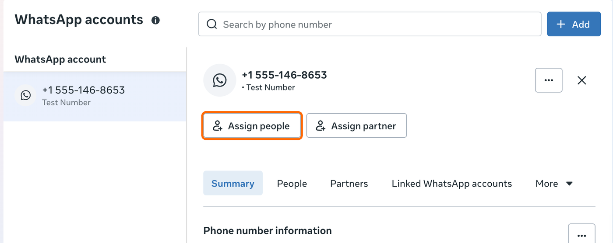
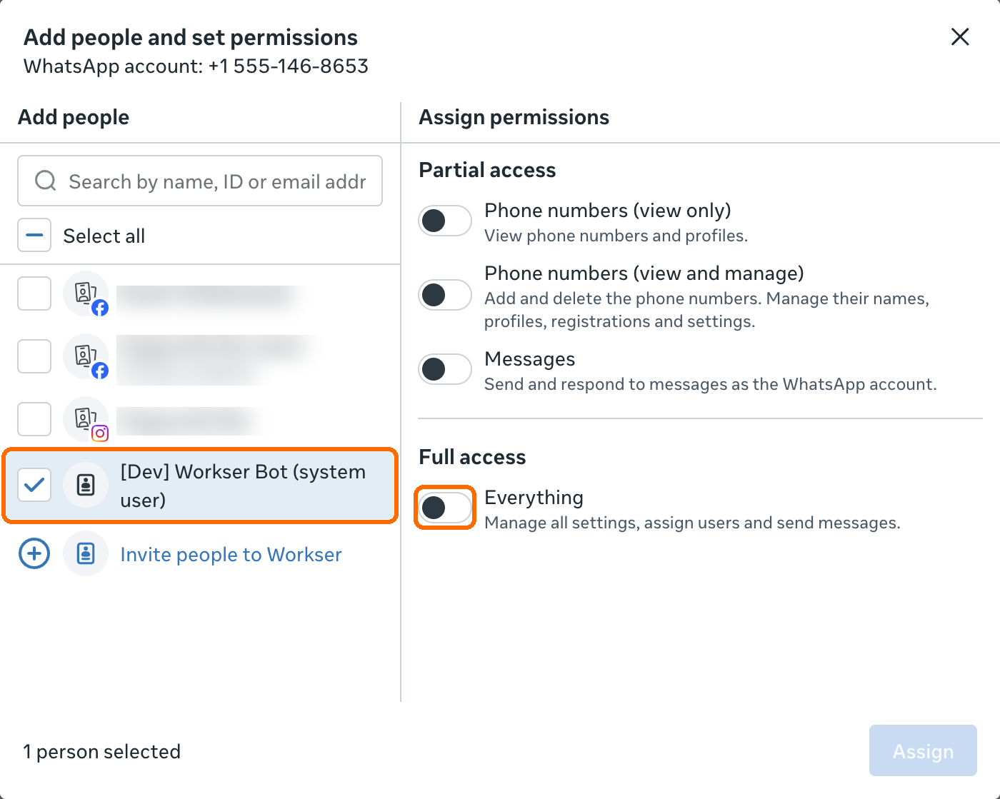
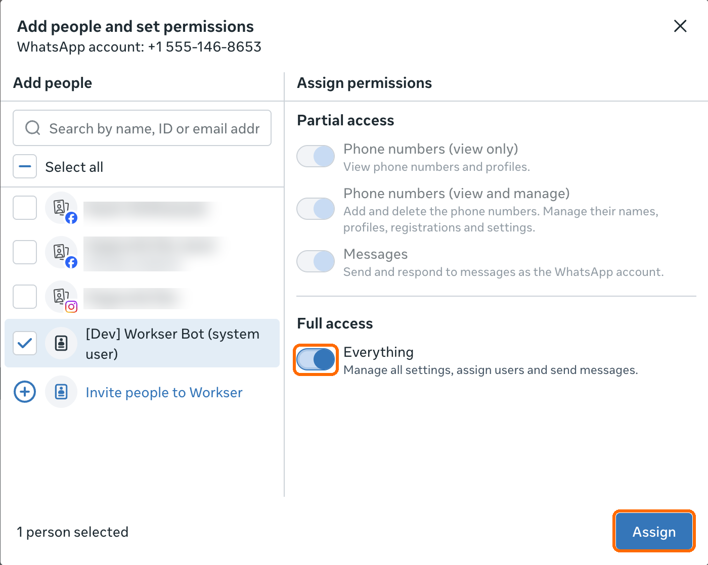
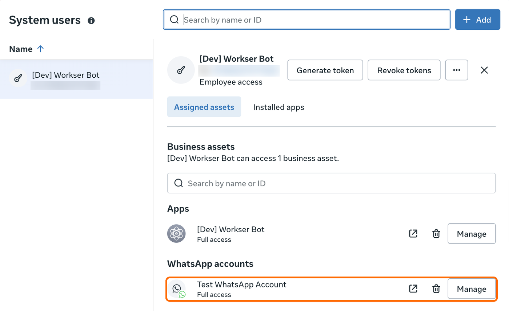

When you press **Connect** for WhatsApp in Workser, you may see:

> WhatsApp does not show that ID to this token. Check the ID, and that the system user has this WhatsApp account assigned.

It means the access key you pasted works, but Meta says that key is **not allowed to see your WhatsApp account**. The fix is to give the key's system user your WhatsApp account, then make a new key. The numbers you typed are usually fine.

<Note>
  Not sure how to make the access key at all? Start with [Get your WhatsApp access key from Meta](/ai-workforce/whatsapp-meta-access-key).
</Note>

<Steps>
  <Step title="Open your WhatsApp account in Meta">
    In [Meta Business Settings](https://business.facebook.com/settings/whatsapp-business-accounts), open **Accounts → WhatsApp accounts** and click your number. Your test number looks like `+1 555-…` and says *Test Number*. If your account is not in this list, it belongs to a different business portfolio or to your personal developer account, and the system user cannot reach it from here.

    <Frame>
      
    </Frame>

    Press **Assign people**.
  </Step>

  <Step title="Pick the system user">
    The list holds the people in your business and your **system users**. Tick the system user you made for Workser. It is marked *(system user)*.

    <Frame>
      
    </Frame>
  </Step>

  <Step title="Give it full access">
    Under **Full access**, turn on **Everything**, then press **Assign**. Workser needs to send messages for this account, and Meta only allows that with this permission.

    <Frame>
      
    </Frame>
  </Step>

  <Step title="Check it, then make a new key">
    Go to **Users → System users**, click the system user, and look at **Assigned assets**. You should see your app and your **WhatsApp account**, both with *Full access*.

    <Frame>
      
    </Frame>

    An access key only knows what the system user had when the key was made, so the old key still cannot see the account. Press **Generate token** and make a new one with the steps in [Get your WhatsApp access key from Meta](/ai-workforce/whatsapp-meta-access-key), then paste it into Workser and press **Connect** again.
  </Step>
</Steps>

## Still the same message?

- Check the **WhatsApp number ID** against Meta's **WhatsApp → API Setup** page. For the **WhatsApp business account ID**, do not use the *Messaging account ID* on that page. [Find the real one in the address bar](/ai-workforce/whatsapp-business-account-id).
- Make sure the new key was made for the same app whose App ID you pasted into Workser.
- Make sure you pasted the new key, not the old one.
