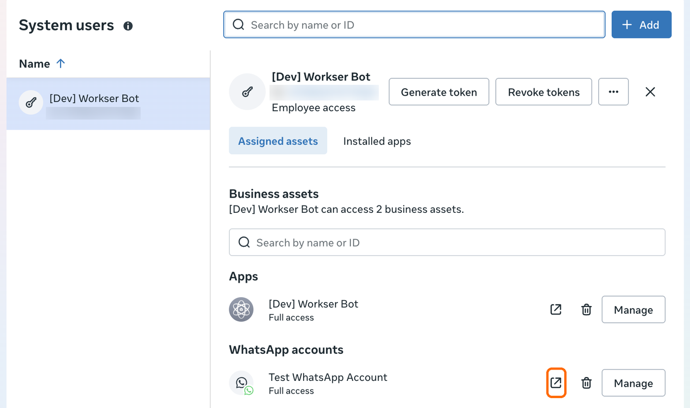
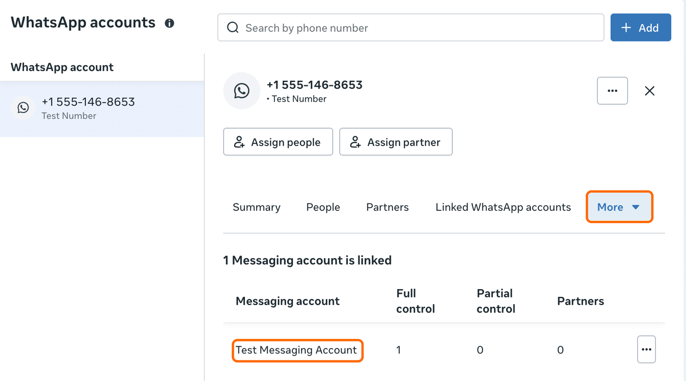
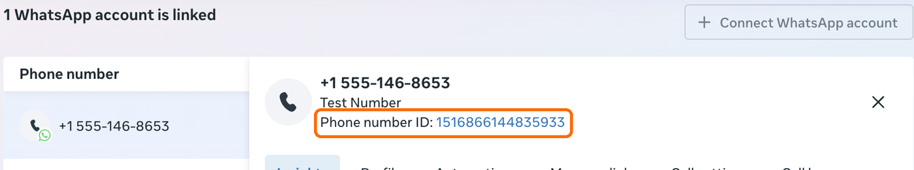

Workser asks for a **WhatsApp business account ID**. Meta shows it on no page with a label, so it is easy to paste the wrong number. This page shows where it really is.

<Warning>
  Do not use the **Messaging account ID** shown on the **API Setup** page. For some accounts, including Meta's free test account, it is a different number, and your access key cannot load it. Workser then says “WhatsApp does not show that ID to this token”.
</Warning>

## Find it in 4 steps

<Steps>
  <Step title="Open your system user">
    In [Meta Business Settings](https://business.facebook.com/settings/system-users), go to **Users → System users** and click the system user you made for Workser.
  </Step>

  <Step title="Find your WhatsApp account">
    Under **Assigned assets**, look for **WhatsApp accounts** and press the small arrow icon at the right of your account (the one before the bin).

    <Frame>
      
    </Frame>
  </Step>

  <Step title="Read the number in the address bar">
    Your account opens in a new tab. Look at the address at the top of the browser. It looks like this:

    ```text
    https://business.facebook.com/latest/settings/whatsapp_business_presence/?business_id=…&selected_asset_id=2433316544083047&selected_asset_type=whatsapp-business-account
    ```

    The long number after **`selected_asset_id=`** is your WhatsApp business account ID. In this example it is `2433316544083047`. The page also says `selected_asset_type=whatsapp-business-account`, which confirms it is the right kind of ID.
  </Step>

  <Step title="Paste it into Workser">
    Copy that number into **WhatsApp business account ID** in the Connect form.
  </Step>
</Steps>

<Tip>
  You can also get there from **Accounts → WhatsApp accounts**: click your account, and look for `selected_asset_id=` in the address bar. It is the same number.
</Tip>

## Why API Setup shows a different number

Meta keeps two records for the same number: a **WhatsApp account** and a linked **Messaging account**. They have different IDs. API Setup shows the **Messaging account ID**, and Workser needs the ID of the **WhatsApp account**.

You can see the two records side by side. In Business Settings, open **Accounts → WhatsApp accounts**, click your number, then open **More**. The linked *Messaging account* is listed there. It is a separate record, so its ID is not the one Workser needs.

<Frame>
  
</Frame>

## Find the phone number ID in WhatsApp Manager

If you cannot find the **Phone Number ID** on API Setup, WhatsApp Manager shows it right under your number. Open **WhatsApp Manager** from your Meta business tools, then **Account tools → Phone numbers**, and click your number. The **Phone number ID** is the line under its name.

<Frame>
  
</Frame>

## Which ID goes where

| Workser field | Where to find it | Example |
|---|---|---|
| **Meta app ID** | developers.facebook.com → your app → **App settings → Basic** | `1493877816174751` |
| **Meta app secret** | the same page, press **Show** | |
| **Access key** | [Get your WhatsApp access key from Meta](/ai-workforce/whatsapp-meta-access-key) | `EAAV…` |
| **WhatsApp number ID** | your app → **Use cases → Customize → API Setup** → **Step 1. Try it out**, the **Phone Number ID** under your number, or **WhatsApp Manager → Phone numbers** (see above) | `1516866144835933` |
| **WhatsApp business account ID** | the address bar, as above (`selected_asset_id=`) | `2433316544083047` |

The **system user ID** (the number under the system user's name) and the **Messaging account ID** are not used in Workser.

## Meta's free test number

Meta's test account refuses some of the account-level calls. Workser skips those and still connects, so you can try Workser with the test number before you add a real one.
