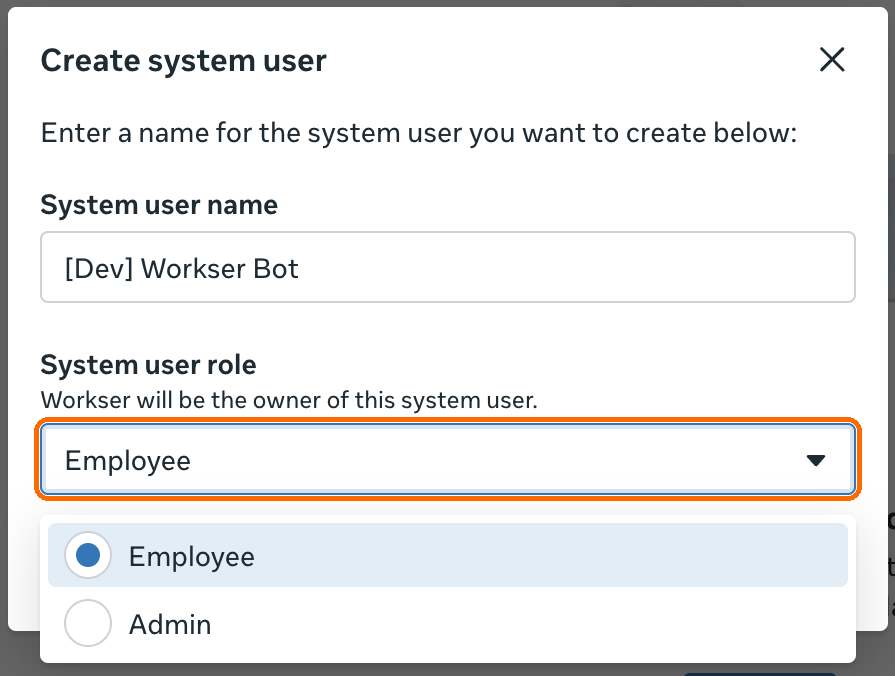
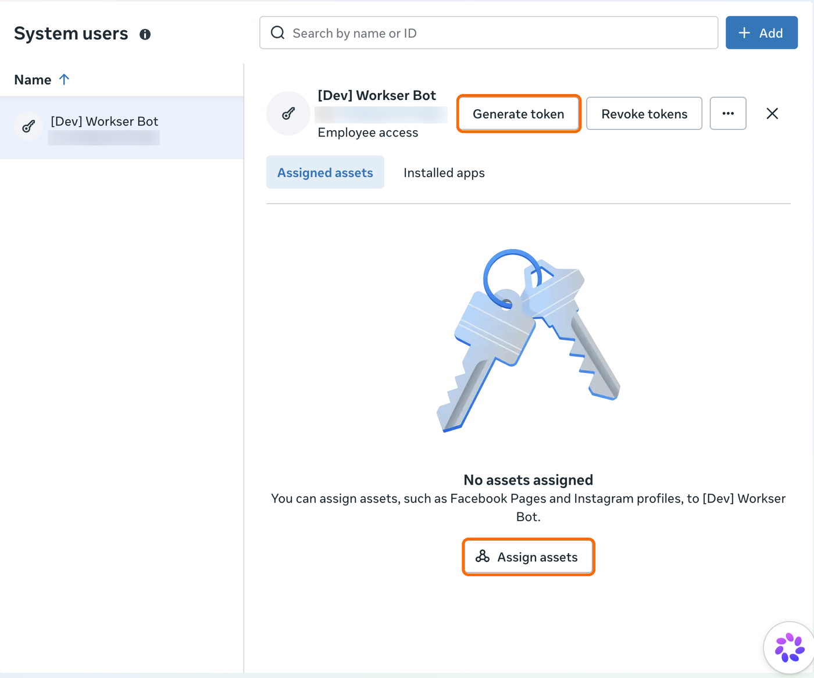
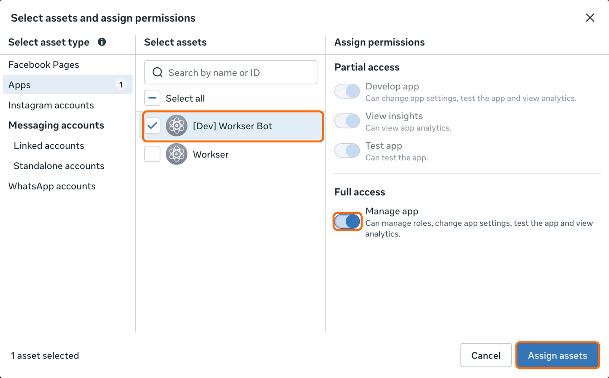
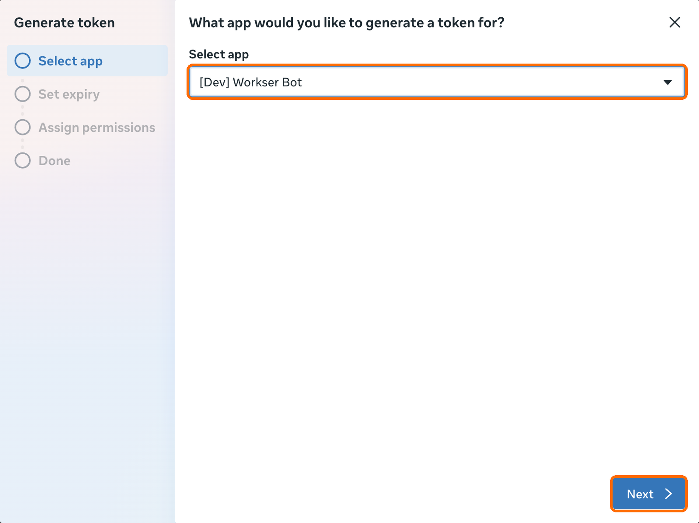
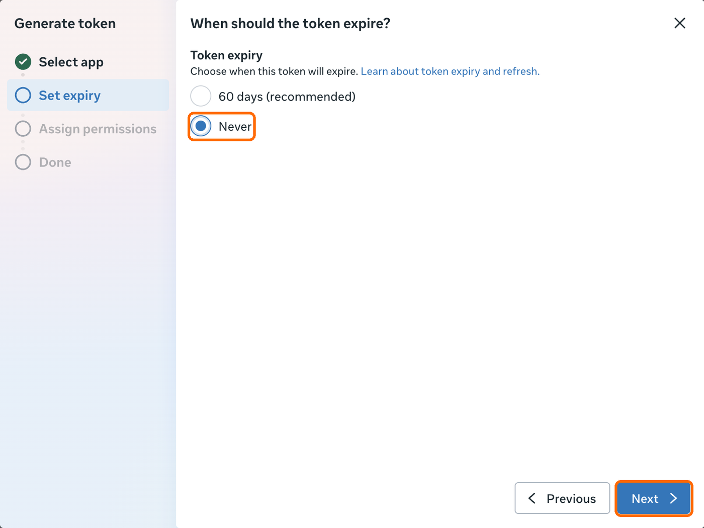
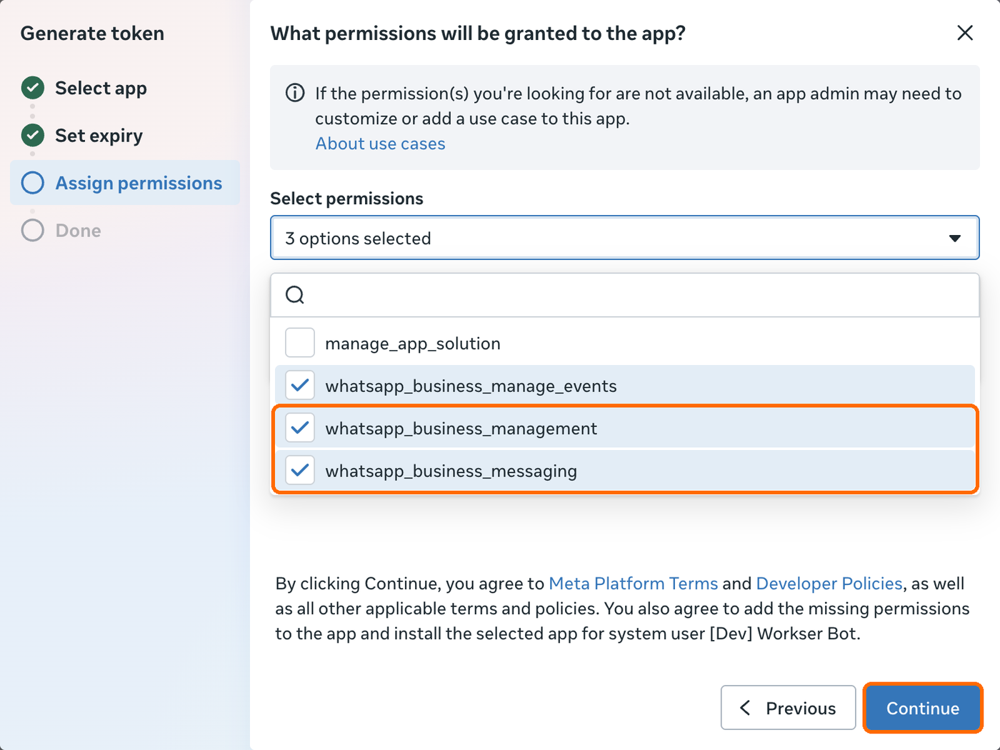
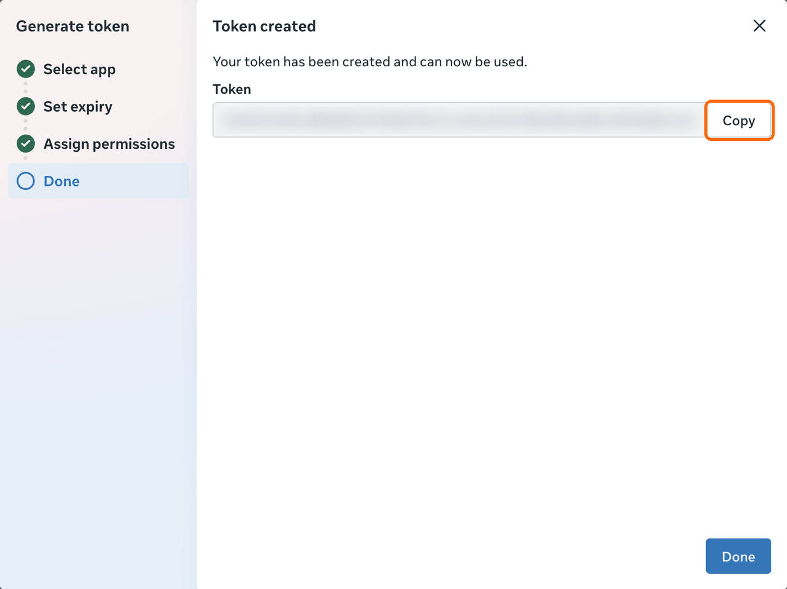
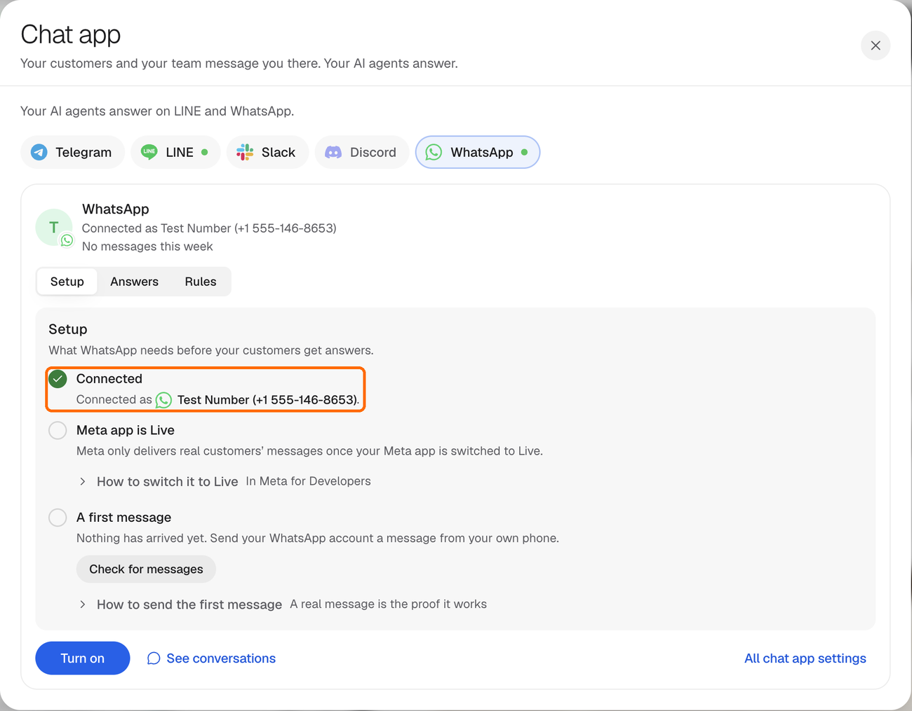
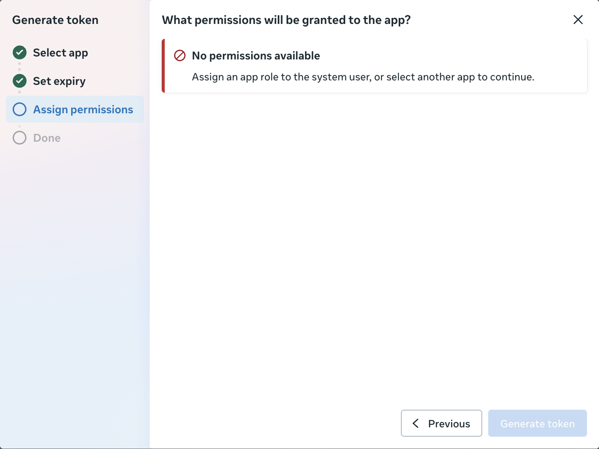

Workser needs one thing from Meta to answer your customers on WhatsApp: an **access key** (Meta calls it an *access token*). It is how Workser sends your AI agent's replies from your number. This page shows how to make it in about 5 minutes.

<Note>
  Just trying it out? On your app's **WhatsApp → API Setup** page, Meta shows a temporary access token that works for 24 hours. You can paste that into Workser to test. For a number that keeps answering customers, make the permanent key below.
</Note>

**Before you start**, you need a Meta Business app with WhatsApp added, and a WhatsApp account, both in the same Meta business portfolio. You open everything below from [Meta Business Settings](https://business.facebook.com/settings/system-users).

<Steps>
  <Step title="Create a system user">
    In Business Settings, open **Users → System users** and press **Add**. Name it anything you like, set the role to **Employee**, and press **Create system user**.

    <Frame>
      
    </Frame>

    Employee is enough. It gives the key access only to what you assign in the next two steps.
  </Step>

  <Step title="Give it your app">
    Click the system user you just made, then press **Assign assets**. Open the **Apps** tab, tick your app, turn on **Manage app**, and press **Assign assets**.

    <Frame>
      
    </Frame>

    <Frame>
      
    </Frame>
  </Step>

  <Step title="Give it your WhatsApp account">
    Press **Assign assets** again. This time open the **WhatsApp accounts** tab (not "Messaging accounts"), tick your WhatsApp account, turn on full control, and press **Assign assets**. If that tab shows nothing to tick, assign it from the other side: [give the system user your WhatsApp account](/ai-workforce/whatsapp-assign-account), with screenshots.

    Workser checks this when you connect. A key that is not allowed to message for your WhatsApp account is refused with “WhatsApp does not show that ID to this token”.
  </Step>

  <Step title="Press Generate token and pick your app">
    On the system user, press **Generate token**. Choose your app in the list and press **Next**.

    <Frame>
      
    </Frame>
  </Step>

  <Step title="Choose when it expires">
    Pick **Never**, then **Next**.

    <Frame>
      
    </Frame>

    Meta suggests 60 days. A key that expires makes your AI agent stop replying until you paste a new one, so Never is the safe choice for a live number. If you pick 60 days, put a reminder in your calendar.
  </Step>

  <Step title="Tick the two WhatsApp permissions">
    Tick **whatsapp_business_messaging** and **whatsapp_business_management**, then press **Continue**. The extra `whatsapp_business_manage_events` is optional.

    <Frame>
      
    </Frame>
  </Step>

  <Step title="Copy the key into Workser">
    Press **Copy**. Meta shows the key only once, so paste it into the **Access key** field in Workser right away, together with your app ID, app secret, number ID and business account ID ([where to find each ID](/ai-workforce/whatsapp-business-account-id)), and press **Connect**.

    <Frame>
      
    </Frame>

    Workser stores it encrypted and never shows it again. If you lose it, make a new one the same way.
  </Step>
</Steps>

## When it works

Workser shows **Connected** with your number's name. This is what it looks like for Meta's free test number.

<Frame>
  
</Frame>

The list under **Connected** shows what is left before customers get answers. Switch your Meta app to **Live** (Workser shows how). Until it is Live, Meta delivers no messages to Workser, not even from your own phone or with Meta’s test number.

<Tip>
  Meta asks for a **Privacy policy URL** before it lets you publish. Use the privacy page of your own business website. No website yet? Ask Workser Code to build a one-page site with a privacy policy for your business and put it online, then paste its link into Meta (**App settings → Basic**).
</Tip>

Then send your WhatsApp number a message from your own phone and press **Check for messages**. A real message that gets an answer is the proof that it works.

## If something goes wrong

<AccordionGroup>
  <Accordion title="Meta says “No permissions available”">
    The system user has no role on your app yet. Close the box, go back to step 2, give the system user your app with **Manage app** turned on, then press **Generate token** again.

    <Frame>
      
    </Frame>
  </Accordion>

  <Accordion title="My app is not in the Apps list">
    The app still belongs to your personal developer account. In Business Settings open **Accounts → Apps → Add → Connect an app ID**, enter your app ID, and approve it. Then repeat step 2.
  </Accordion>

  <Accordion title="Workser says the key is for a different app">
    The key must be made for the same app whose ID you pasted. Generate it again and choose that app in step 4.
  </Accordion>

  <Accordion title="Workser says “WhatsApp does not show that ID to this token”">
    The system user does not have your WhatsApp account yet. Follow [Fix: WhatsApp does not show that ID to this token](/ai-workforce/whatsapp-assign-account), then make a new key.
  </Accordion>

  <Accordion title="Workser says the key is missing a permission or cannot message for the account">
    Check step 3 (the WhatsApp account with full control) and step 6 (both WhatsApp permissions ticked). Then make a new key and connect again.
  </Accordion>
</AccordionGroup>

Back to [linking chat apps](/ai-workforce/chat-apps).
